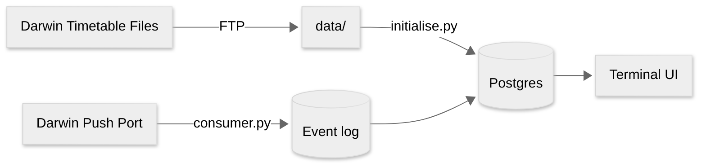

# TrainTrack

TrainTrack uses NationalRail's Darwin Feed for tracking UK trains live

Journeys, Stops & Updates are all stored in Postgres.

## Requirements

- A [RailData](https://raildata.org.uk/) account subscribed to (both currently free):
  - [Darwin Real Time Train Information (Push)](https://raildata.org.uk/dashboard/dataProduct/P-3f10bf96-d8e8-4041-aa5e-d75d82c45c4e/overview)
  - [Darwin Timetable Files](https://raildata.org.uk/dashboard/dataProduct/P-9ca6bc7e-62e1-44d6-b93a-1616f7d2caf8/overview)
- An FTP server that RailData can deliver the timetable files to
- Python 3.12+ and [uv](https://docs.astral.sh/uv/)
- Docker (for Postgres)

## Setup

1) Set up an FTP Server (timetable files must end up in `data/` to be loaded)
1) Set up a [RailData](https://raildata.org.uk/) account
1) Subscribe to [Darwin Real Time Train Information (Push)](https://raildata.org.uk/dashboard/dataProduct/P-3f10bf96-d8e8-4041-aa5e-d75d82c45c4e/overview) and take note of your Kafka credentials and configuration
1) Subscribe to [Darwin Timetable Files](https://raildata.org.uk/dashboard/dataProduct/P-9ca6bc7e-62e1-44d6-b93a-1616f7d2caf8/overview), configure the FTP location to point at the `data/` folder
1) Copy `.env.example` to `.env` and set the values to the ones RailData provides
1) Run `docker compose up -d` to launch Postgres and Adminer
1) Apply database migrations (`uv run src/migrate.py`)

### Running everything in Docker

`docker compose up -d --build` also starts two app services:

- `consumer` applies migrations, then consumes the Push Port continuously (restarts if it crashes)
- `timetable` loads the timetable from `data/` on start, then again every day at 05:00 UK time

## Usage
- `uv run src/migrate.py`: Apply all pending database migrations from `sql/`
- `uv run src/initialise.py`: Seed the journey and reference tables from the daily timetable (`data/`, configure [Darwin Timetable Files](https://raildata.org.uk/dashboard/dataProduct/P-9ca6bc7e-62e1-44d6-b93a-1616f7d2caf8/overview) to point here). **Run this before you run `consumer.py`**
- `uv run src/consumer.py`: Run the main consumer. Every Push Port message is stored in `darwin_events`, then applied: train statuses (actual and forecast times, platforms, late reasons), new or changed schedules, and deactivations
  - `--record FILE` also saves every raw message to `FILE`, which is useful for building test fixtures
- `uv run src/initialise.py --daily 05:00`: Load the timetable now, then again every day at that time
- `uv run pytest`: Run the tests. Database tests need `TEST_DATABASE_URL` pointing at a database that can be wiped
- `uv run src/search.py`: Run the train data viewer (CLI)

## Planned work

- [x] Add a way to query a train's latest reported location (`train_journeys.last_tiploc`, `last_reported_at`, `delay_minutes`)
- [ ] A live web map of every train, with replay of past days
- [ ] A terminal ui for initial setup and configuration

## Not currently planned

- Darwin supports S3 Buckets in addition to the FTP server, which can also be used to seed the timetable

## Changelog

See [CHANGELOG.md](CHANGELOG.md) for release notes

## Acknowledgments

[NationalRail Data](https://www.nationalrail.co.uk/developers/) - Providing the API and data that made this project possible

## License

[MIT](LICENSE)
