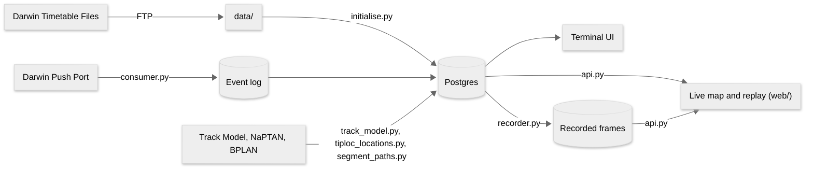

# TrainTrack

TrainTrack uses NationalRail's Darwin Feed for tracking UK trains live, and draws every train on a map, moving along the real track.

Journeys, Stops & Updates are all stored in Postgres with PostGIS, alongside Network Rail's Track Model and a location for every TIPLOC.

## Requirements

- A [RailData](https://raildata.org.uk/) account subscribed to (both currently free):
  - [Darwin Real Time Train Information (Push)](https://raildata.org.uk/dashboard/dataProduct/P-3f10bf96-d8e8-4041-aa5e-d75d82c45c4e/overview)
  - [Darwin Timetable Files](https://raildata.org.uk/dashboard/dataProduct/P-9ca6bc7e-62e1-44d6-b93a-1616f7d2caf8/overview)
- An FTP server that RailData can deliver the timetable files to
- Python 3.12+ and [uv](https://docs.astral.sh/uv/)
- Docker (for Postgres with PostGIS)
- For the map: Node 22+ and [pnpm](https://pnpm.io/), and these files in `data/`:
  - Network Rail's Track Model (`data/trackmodel/NWR_TrackModel*.zip`)
  - NaPTAN stops (`data/naptan/Stops.csv`)
  - Network Rail BPLAN (`data/bplan/PIF*.txt.gz`)

## Setup

1) Set up an FTP Server (timetable files must end up in `data/` to be loaded)
1) Set up a [RailData](https://raildata.org.uk/) account
1) Subscribe to [Darwin Real Time Train Information (Push)](https://raildata.org.uk/dashboard/dataProduct/P-3f10bf96-d8e8-4041-aa5e-d75d82c45c4e/overview) and take note of your Kafka credentials and configuration
1) Subscribe to [Darwin Timetable Files](https://raildata.org.uk/dashboard/dataProduct/P-9ca6bc7e-62e1-44d6-b93a-1616f7d2caf8/overview), configure the FTP location to point at the `data/` folder
1) Copy `.env.example` to `.env` and set the values to the ones RailData provides
1) Run `docker compose up -d` to launch Postgres and Adminer
1) Apply database migrations (`uv run src/migrate.py`)
1) For the map, load the track and locations once (and again when the files change):
   `uv run src/track_model.py`, `uv run src/tiploc_locations.py`, then `uv run src/segment_paths.py` (the timetable loader also routes each new day's stop pairs)

### Running everything in Docker

`docker compose up -d --build` also starts two app services:

- `consumer` applies migrations, then consumes the Push Port continuously (restarts if it crashes)
- `timetable` loads the timetable from `data/` on start, then again every day at 05:00 UK time
- `recorder` records what the map shows every 5 s, so any moment can be replayed
- `api` serves live positions, replay and the map on http://localhost:8000 (`MAP_CLOCK` in `.env` can replay a past moment)

The `timetable` service also runs `retention.py` each day, which writes raw events older than 14 days to `data/archive/` and drops them from Postgres (see [Replay and retention](#replay-and-retention)).

## Usage
Quick starts (`./run.sh` lists them):
- `./run.sh db`: Postgres and Adminer; `./run.sh up`: everything in Docker; `./run.sh down`: stop them
- `./run.sh dev`: the database, then the API and the map's dev server (http://localhost:5173); Ctrl+C stops both
- `./run.sh replay [ISO time]`: the same, replaying a past moment; `./run.sh live`: the same plus the consumer
- `./run.sh api [clock]`, `./run.sh web`, `./run.sh consumer`: one part on its own

- `uv run src/migrate.py`: Apply all pending database migrations from `sql/`
- `uv run src/initialise.py`: Seed the journey and reference tables from the daily timetable (`data/`, configure [Darwin Timetable Files](https://raildata.org.uk/dashboard/dataProduct/P-9ca6bc7e-62e1-44d6-b93a-1616f7d2caf8/overview) to point here). **Run this before you run `consumer.py`**
- `uv run src/consumer.py`: Run the main consumer. Every Push Port message is stored in `darwin_events`, then applied: train statuses (actual and forecast times, platforms, late reasons), new or changed schedules, and deactivations
  - `--record FILE` also saves every raw message to `FILE`, which is useful for building test fixtures
- `uv run src/initialise.py --daily 05:00`: Load the timetable now, then again every day at that time
- `uv run pytest`: Run the tests. Database tests need `TEST_DATABASE_URL` pointing at a database that can be wiped
- `uv run src/search.py`: Run the train data viewer (CLI)
- `uv run src/api.py`: Serve the API and the built map on http://localhost:8000
  - `--clock now` (default), `fixed:2026-11-21T14:30Z` (frozen at that moment) or `replay:2026-11-21T14:30Z` (runs forward from it)
  - Routes: `/api/positions` (`?at=` for any moment), `/api/stream` (server-sent deltas), `/api/trains/{rid}` (`?at=` too), `/api/replay` (stored frames), `/api/replay/days`, `/api/replay/runs`, `/api/segments`, `/api/stations`, `/api/operators`, `/api/health`, and `/tiles/track/{z}/{x}/{y}.pbf`
- `uv run src/recorder.py`: Record the map every 5 s for replay
  - `--backfill 2026-11-21T13:50Z 2026-11-21T14:51Z` computes frames for a window before recording started (marked `computed`)
- `uv run src/retention.py`: Make the event log's day partitions ahead, and archive and drop expired days (`--dry-run` to see what it would do)
- `uv run src/track_model.py`, `uv run src/tiploc_locations.py`, `uv run src/segment_paths.py`: Load the track, place every TIPLOC (hand fixes in `reference/tiploc_overrides.csv`), and route each pair of consecutive stops along the track

### The map (`web/`)
- `pnpm install`, then `pnpm dev` serves the map on http://localhost:5173, calling the API on port 8000 (`TRAINTRACK_API` changes that)
- `pnpm build` builds it into `web/dist`, which `api.py` serves
- The timeline at the bottom replays any moment: pick a day, drag the slider, play at 1×, 10× or 60×, or go back to Live. The slider is shaded where frames were stored
- The address holds what's on screen, so it can be shared: `?at=2026-11-21T14:30Z&speed=10&paused=1&train=<rid>#map=11/51.46/-0.17`; press `/` to search
- `pnpm test` (unit), `pnpm test:e2e` (Playwright tests against their own API on a replay clock; need Chrome, that day's data and its backfilled frames), `pnpm lint`, `pnpm bench` (frame timings in headless Chrome)
- `pnpm gen:api` regenerates the API types after changing `api.py`

## Replay and retention

Replay plays back what the map showed, recorded as it happened by `recorder.py` into `position_frames`: a keyframe of every train every 5 minutes, and each 5 s tick's changes in between (about 55 MB a day). The consumer overwrites train times in place, so the past can't be rebuilt reliably from the database later. For moments before recording started, `recorder.py --backfill` computes frames from the database as it is now; these are marked `computed`, and later forecasts or cancellations can show through in them. Where there are no frames at all, the map shows positions computed on request, marked "not recorded".

Raw Push Port messages stay in `darwin_events`, one partition per UK day, for `EVENTS_KEEP_DAYS` (14). After that `retention.py` writes each day to `data/archive/darwin_events-YYYY-MM-DD.jsonl.gz` (about 120 bytes a message, roughly 250 MB a day) and drops its partition. Frames are kept forever unless `FRAMES_KEEP_DAYS` is set.

## Planned work

- [x] Add a way to query a train's latest reported location (`train_journeys.last_tiploc`, `last_reported_at`, `delay_minutes`)
- [x] A live web map of every train, with replay of past days
- [ ] A terminal ui for initial setup and configuration

## Not currently planned

- Darwin supports S3 Buckets in addition to the FTP server, which can also be used to seed the timetable

## Changelog

See [CHANGELOG.md](CHANGELOG.md) for release notes

## Acknowledgments

[NationalRail Data](https://www.nationalrail.co.uk/developers/) - Providing the API and data that made this project possible

## License

[MIT](LICENSE)
