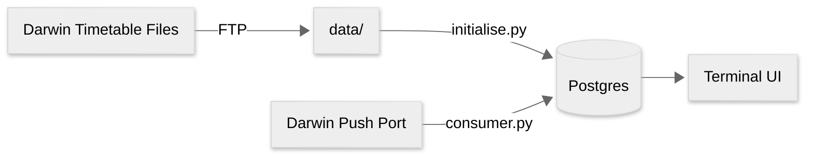

# TrainTrack

TrainTrack uses Nation Rail's Darwin Feed for tracking UK trains live

Journeys, Stops & Updates are all stored in postgres

## Requirements

- A [RailData](https://raildata.org.uk/) account subscribed to (both currently free):
  - [Darwin Real Time Train Information (Push)](https://raildata.org.uk/dashboard/dataProduct/P-3f10bf96-d8e8-4041-aa5e-d75d82c45c4e/overview)
  - [Darwin Timetable Files](https://raildata.org.uk/dashboard/dataProduct/P-9ca6bc7e-62e1-44d6-b93a-1616f7d2caf8/overview)
- An FTP server that RailData can deliver the timetable files to
- Python 3.12+ and [uv](https://docs.astral.sh/uv/)
- Docker (for Postgres)

## Setup

1) Set up an FTP Server (timetable files must end up in `data/` to be loaded)
1) Set up a [RailData](https://raildata.org.uk/) account
1) Subscribe to [Darwin Real Time Train Information (Push)](https://raildata.org.uk/dashboard/dataProduct/P-3f10bf96-d8e8-4041-aa5e-d75d82c45c4e/overview) and take note of your kafka credentials and configuration
1) Subscribe to [Darwin Timetable Files](https://raildata.org.uk/dashboard/dataProduct/P-9ca6bc7e-62e1-44d6-b93a-1616f7d2caf8/overview), configure the FTP location to point at the `data/` folder
1) copy `.env.example` to `.env` and set the values to the ones Raildata provides
1) Run `docker compose up -d` to launch postgres and adminer
1) Apply database migrations (`uv run src/migrate.py`)

## Usage
- `uv run src/migrate.py`: Apply all pending database migrations from `sql/`
- `uv run src/initialise.py`: Seed the journey and reference tables from the daily timetable (`data/`, configure [Darwin Timetable Files](https://raildata.org.uk/dashboard/dataProduct/P-9ca6bc7e-62e1-44d6-b93a-1616f7d2caf8/overview) to point here). **Run this before you run `consumer.py`**
- `uv run src/consumer.py`: Run the main consumer, updating the database with realtime data
- `uv run src/search.py`: Run the train data viewer (CLI)

## Planned work

- [x] Import the daily timetable and reference data.
- [ ] Add a way to query a train's latest reported location.
- [ ] A terminal ui for inital setup and configuration

## Not currently planned

- Darwin supports S3 Buckets in addition to the FTP server, which can also be used to seed the timetable

## Changelog

The project changelog can be found [here](CHANGELOG.md)

## Acknowledgments

[NationalRail Data](https://www.nationalrail.co.uk/developers/) - Providing the API and data that made this project possible

## License

[MIT](LICENSE)
